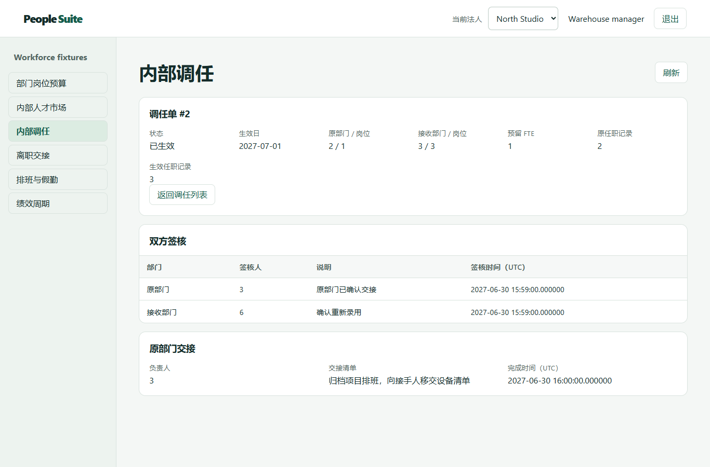

# 编制预算与内部人才市场

一个部门拟在下半年增设岗位。主管提交预算，人力伙伴复核职级，财务批准后只占用七月至十二月的额度。岗位发布后，员工查看资格缺口、自愿投递。两名评委独立提交意见，HR 核对录用和编制后发起调任，原部门和接收部门分别签核。工作台保留原部门交接记录，并可按工资期间复查成本。



## 工作台与权限

| 入口 | 办理人 | 可核对的结果 |
| --- | --- | --- |
| 年度编制情景 | HR、财务复核人 | 同年各情景的月末 FTE、月成本差额、实际任职与已封账成本。HR 发布或修订基线。 |
| 部门岗位预算 | 获部门授权的经理、HR、财务复核人 | 各月金额与编制预留、决定人、退回原因、修订前后成本。申报人与复核人独立。 |
| 技能与证据 | 员工、指定验证人 | 作品地址或凭据编号、验证意见、到期日、本人选择的公开范围。 |
| 内部人才市场 | 员工、用人经理、面试组 | 硬性和加分技能、已授权证据、申请状态及独立评分。 |
| 内部调任 | HR、两边主管、员工与交接负责人 | 目标编制、合同、两次签核、原岗位交接、到期回执及新任职编号。 |
| 月度岗位流动 | HR、财务复核人 | 内部与外部到岗数、原任职结束数、填补率和每个空缺的起止日。 |

集团和法人决定数据范围。经理的部门预算授权由 HR 办理。岗位至少两位评委，自评和同一人代表双方签核均被拒绝。证据默认为私有，指定评审人可以核验。员工撤回共享后，搜索和已经投递的候选材料随即按新授权展示。证书有效至业务日结束。

## 跑一次演示

按 [本地启动说明](../README.md) 准备独立的 `hcm_test_*` 库。在源码根目录执行以下命令，测试用数据库与网页服务使用同一组数据库环境变量。Windows PowerShell 可用 `$env:HCM_MOVE_EVIDENCE='storage/mobility.json'` 设置输出位置。

```sh
export HCM_MOVE_EVIDENCE=storage/mobility.json
php bin/hcm.php migrate
php tests/recruitment.php
php -S 127.0.0.1:8080 -t public public/index.php
```

打开工作台，使用生成文件中的 `group` 和演示口令 `Synthetic-assertions-44`。原部门经理为 `dept-manager@example.test`，在「内部调任」中可查看一份已撤回单和重签后的生效单。财务账号 `finance@example.test` 在 North Studio 的「薪资账期」可核对 2027 年六月与七月的封账凭据。每次运行创建独立合成集团，数据库名称限定为测试库。

浏览器验证可用 Python Playwright 执行。安装 Chromium 后运行 `python tests/mobility_workbench.py http://127.0.0.1:8080 storage/mobility.json`。可用 `--chrome` 指定本机浏览器。发行中的 [原始输入、两次录用、撤回及封账回执](mobility-acceptance.json) 来自一次独立运行。

## 导入与计算

从[样例 CSV](workforce-baseline.csv)开始，将部门编号改为本法人实际部门编号。日期区间包含起日、排除止日。10000 个基点表示 1 FTE，每行月成本为该任职的实际预算。样例的一名全职和两名半职合计 2 FTE，整月成本合计 2400000 个货币最小单位。当月生效或结束的任职按实际自然日折算成本，人数按月末取数。Web 适合小批量，较大的文件可从命令行导入，口令从标准输入读取。

```sh
php bin/hcm.php import-plan north-demo hr@example.test 1 2027 BASE 0 年度基线 baseline-1 docs/workforce-baseline.csv
```

修订时使用相同年度和情景代码，填写上一修订号，换一个请求键。原快照仍可查询。物理岗位编制由 HR 在岗位配置中设定，部门财务预算与物理空缺都必须可用才可预留。报表中的计划与实际成本使用法人币种。未封账月份的实际成本显示为空。

月报的填补率为本月实际内部到岗数除以全部到岗数。外部招聘以录用入职和首条任职匹配，内部调任按生效任职计数。分母为零时显示空值。岗位自发布日累计空缺自然日，到岗日结束计数，跨月拆分，当前月最多计算至当前业务日。投递截止日只决定能否接受申请。

## 调任接口与定时办理

先通过工作台或 `GET /api/companies/{company}/talent/offers` 获取待录用申请。按拟生效日访问 `GET /api/companies/{company}/talent/offers/{application}?effective_date=2027-07-01` 查询资格、合同和空缺。HR 通过 `POST /internal-moves?company_id={company}` 提交预留。会话、CSRF 和请求键格式见 [HTTP API](http-api.md)。

```json
{"application_id":3,"from_position":1,"to_position":4,"effective_date":"2027-07-01","offer_rev":2}
```

收到 `move_id` 后，在 `/api/companies/{company}/talent/moves/{move_id}` 读取详情和当前账号可办理的操作。各操作以 POST 提交，携带当前修订与独立请求键。原主管签核需提供交接清单和负责账号。跨法人接收方 HR 先提交新合同，接收主管再签核。生效前可撤回，已生效调任的反向流动须另建业务单。

调度器按接收法人运行以下命令。服务使用法人的 IANA 时区判断是否到达生效日，每批 50 单。成功单返回新任职编号，重试不会重复建档。逐页传入返回的 `next_after`，下一轮从 0 开始。失败单保留原因，HR 可修复后重试，或在核实无法生效后记录原因并释放占用。

```sh
php bin/hcm.php apply-due-moves north-demo hr@example.test 1 0
```

## 从 v1.1.0 升级

1. 从备份还原隔离副本，将当前源码的 CLI 指向旧结构，先执行 `php bin/hcm.php workforce-rollout north-demo hr@example.test 1 preflight`。保存岗位归属冲突编号、岗位占用摘要、工资封账摘要和记录数。
2. 部署新代码并运行 `php bin/hcm.php migrate`。已有法人进入 setup，新建空法人可直接使用。分批运行 `php bin/hcm.php workforce-rollout north-demo hr@example.test 1 backfill 100`。每批独立提交，重启后继续。修订过的旧岗位也会重新参与核对。
3. 核对 `remaining_baseline` 为 0，再以 `activate` 代替 `backfill 100` 启用法人。切换期间停止旧进程写入岗位，核对工作台的历史工资与岗位。岗位占用、工资明细及个人技能可见范围均保留原业务记录。
4. 以 `drain` 停止新增申报、岗位、证据、竞聘、预留和情景发布。`status` 返回待审批、待核验、候选申请及调任编号。已受理的签核、撤回、到期处理和原请求重放继续可用。保存未决清单、数据库以及作品引用指向的外部附件，恢复后核对附件编号、工资摘要和已经生效的调任，再切换服务。

[升级演练回执](workforce-upgrade.json)记录了从 v1.1.0 中断后续跑、停止受理及恢复至独立数据库的结果。系统保存证据引用，外部文件由所在文件系统备份。计划容量实测覆盖 500 部门、2 万条任职、12 个月，预热一次后运行三次；样本和运行环境见[容量原始记录](workforce-capacity.json)。实际完成时间取决于机器、业务数据和同时运行的任务。

## 验收用例与样本来源

| 编号 | 核对动作 | 可复现的检查 |
| --- | --- | --- |
| A1、A2 | 1 名全职与 2 名半职合计 2 FTE，修订一条半职成本后原情景仍可回读 | [年度情景 HTTP 用例](../tests/http_smoke.py) |
| A3、A4 | 下半年岗位只预留 6 个月，两笔并发申请中一笔转待调整，修改后保留两版记录 | [部门预算事务](../tests/workforce-budgets.php) |
| A5、A6 | 证书到期次日失效；撤回授权后，搜索和评委工作台均不再显示该证据 | [证据验证与权限](../tests/internal-market.php) |
| A7、A8 | 显示缺少的必需技能，评委只见主动投递给自己岗位的材料 | [竞聘与面试组](../tests/internal-market.php) |
| A9、A10 | 两名候选人争一岗；已签调任撤回后，物理编制和后续预算期间恢复可用 | [双会话争用与撤回](../tests/internal-moves.php) |
| A11、A12 | 按归属月核对已封账工资，撤回应保留原工资单行号及校验摘要 | [工资核验](../tests/mobility-payroll.php) |
| A13 | 重新双签，上海零点只建立一条新任职；经理回查交接，财务复核六月、七月封账 | [工作台验收](../tests/mobility_workbench.py) · [跨法人合同](../tests/internal-cross-company.php) |
| A14 | 500 部门、2 万条任职生成 6000 条部门月汇总；经理尝试读取工资单时收到拒绝 | [容量程序](../tests/workforce-capacity.php) · [HTTP 权限测试](../tests/http_smoke.py) |

样例机构、证据编号、薪资、岗位、交接内容和员工均由仓库的测试代码生成，随项目按 Apache-2.0 提供。发行记录中的调任单 1 已撤回，单 2 在 2027 年 7 月 1 日生效。复现时编号及运行摘要随独立库生成，工具核对本轮业务回执、岗位与两期工资。可按 [备份与恢复说明](backup-and-restore.md) 导出及还原整个样例。
